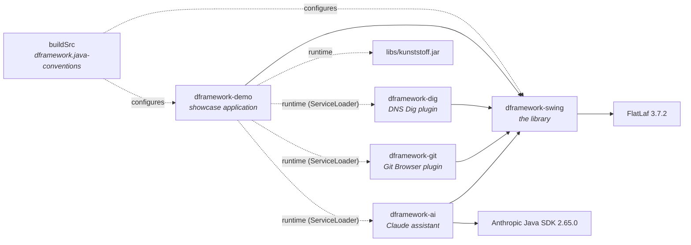

# DFramework Technical Manual

**What this covers:** how DFramework is built and why. It records the design
decisions, the alternatives we rejected, and the traps we hit (several were
caught only by tests).

**Who it's for:** anyone maintaining or extending the framework, including a
future us.

**Using the framework instead?** Read the [User Guide](USER_GUIDE.md).

---

## Contents

1. [History and goals](#1-history-and-goals)
2. [Design principles](#2-design-principles)
3. [Architecture](#3-architecture)
4. [Build system](#4-build-system)
5. [Cross-cutting decisions](#5-cross-cutting-decisions)
6. [Component design notes](#6-component-design-notes)
7. [Testing strategy](#7-testing-strategy)
8. [Legacy to modern mapping](#8-legacy-to-modern-mapping)
9. [Known limitations](#9-known-limitations)
10. [Roadmap](#10-roadmap)
11. [Conventions for contributors](#11-conventions-for-contributors)

---

## 1. History and goals

| Year | Milestone |
|---|---|
| 2001 | `DFrame` and the window closers, written for JDK 1.3 |
| 2005 | *Tracker 2*, a VB6 call-logging application, used an Outlook-style navigation bar |
| 2007 | The Outlook bar and a focus-highlighting text field are reproduced in Swing (that code was later lost) |
| 2012 | `DFrame` 3.0: Java 5 enums, `KnownLookAndFeels`, JUnit 3/4 Robot tests, an Eclipse/Java 6 project |
| 2026 | The revival: Java 21, Gradle, FlatLaf, a full rebuild and new components |

The original sources survive in `dframework.zip` and in the commit *"Import
original 2012 DFramework sources"*. Everything later is a redesign, not a
port. Breaking the 2012 API was explicitly acceptable.

**Goals, in order:**

1. Modernise the existing code.
2. Add new components, including rebuilding the lost 2007 ones.
3. Later, branch out into JavaFX ([§10](#10-roadmap)).

---

## 2. Design principles

These decided most of the questions that came up during the rebuild.

### P1. Better defaults, same Swing

Every component **is** the Swing component it improves: `DFrame extends
JFrame`, `DTable extends JTable`, `DToggleSwitch extends JToggleButton`,
`DTextField extends JTextField`. Existing knowledge, listeners, `Action`s,
layouts and accessibility support all carry over. We add behaviour and
change defaults; we don't invent parallel component hierarchies.

### P2. Work on code that wasn't written for DFramework

Where possible, a feature improves plain Swing without changes to the
calling code:

- `MessageIcons` styles every `JOptionPane`.
- `FocusHighlighter.enableGlobally` highlights every text field.
- `DCommandPalette` harvests the existing menu bar.

One line in `main` should be enough to see the benefit.

### P3. Theme-aware, never theme-hostile

DFramework doesn't hard-code colours that only work on one theme:

- Colours come from `UIManager` keys, with fallback chains.
- Shades are blends of the theme's own background and foreground.
- Anything shown on a background (highlights, stripes, cards) checks
  whether the theme is dark.

Fixed colours appear only as deliberate, documented choices: toast type
accents, the classic Outlook style, and the yellow highlight default.

### P4. Fail loudly, not silently

The 2012 code wrapped every failure in `printStackTrace` and carried on.
Now:

- A missing theme throws `ThemeException`.
- A missing icon throws `IllegalArgumentException` naming the path.
- Unhandled background-task errors are logged through `System.Logger`.

### P5. Be honest about global state

A Swing look and feel is application-wide, as are `UIManager` overrides
and `JFrame.setDefaultLookAndFeelDecorated`. The 2012 API pretended a
theme belonged to a frame. Now anything global is a static facade
(`ThemeManager`, `MessageIcons`, `FocusHighlighter.enableGlobally`, the
`DToast` defaults), and anything per-component is an instance property.

### P6. Testable without a robot

The 2012 tests drove real dialogs with `java.awt.Robot` keystrokes. They
were slow, needed a display, and one of them killed the JVM. Now:

- Behaviour is separated from presentation behind small seams (for
  example `ConfirmCloser.Prompt`).
- Logic that doesn't need components is pulled out into its own classes
  (`FuzzyMatcher`, `TableFilter`).
- Lightweight components are tested headless. See [§7](#7-testing-strategy).

### P7. Lightweight over heavyweight

Toasts, the command palette and the busy overlay are drawn **inside** the
window (in the `JLayeredPane` or a `JLayer`), not in separate undecorated
windows. They fade with real alpha, move with the window, and avoid
platform quirks. On Wayland in particular, a program can't freely position
its own popup windows, and transparency is unreliable.

---

## 3. Architecture

### Modules



| Module | Purpose |
|---|---|
| `dframework-swing` | The library, published as `com.dframework:dframework-swing` |
| `dframework-demo` | The showcase (`./gradlew :dframework-demo:run`). It's also the integration test bed: every component is used here as an application would use it |
| `dframework-ai` | `ClaudeAssistant`, an `AiAssistant` backed by the Anthropic Java SDK. Optional, so the library itself carries no SDK dependencies; found through `ServiceLoader` |
| `dframework-git` | The Git Browser plugin. Like DNS Dig, the demo has it only on its runtime classpath |
| `dframework-dig` | The DNS Dig plugin. It depends on the library; the demo has it only on its *runtime* classpath and finds it through `ServiceLoader`, which proves the plugin mechanism end to end |
| `buildSrc` | One convention plugin shared by every module |

### Packages (`com.dframework.swing`)

| Package | Contents |
|---|---|
| *(root)* | `DFrame`, `CloseAction`, `WindowState`, `WindowMemory` |
| `theme` | `DTheme`, `ThemeManager`, `ThemeException` |
| `close` | `ConfirmCloser` |
| `dialog` | `MessageIcons`, `MessageType` |
| `field` | `DTextField`, `Validator`, `InputFilter`, `FocusHighlighter`, `DSearchField` |
| `table` | `DTable`, `DTablePanel`, `TableFilter` *(package-private)* |
| `nav` | `DOutlookBar`, `DBreadcrumbBar` |
| `command` | `DCommandPalette`, `Command`, `FuzzyMatcher` *(package-private)* |
| `notify` | `DToast` |
| `button` | `DToggleSwitch` |
| `busy` | `DBusyPanel` |
| `panel` | `DCollapsiblePane` |
| `audit` | `AuditLog` |
| `plugin` | `DPlugin`, `PluginContext`, `DPluginPane`, `DPluginHost` |
| `ai` | `AiAssistant`, `AiPrompt`, `AiAnswer`, `AiException`, `DExplainPane` |
| `exec` | `CommandRunner`, `CommandLines`, `DCommandPane` |
| `util` | `DResources` |

Resources live under `com/dframework/swing/`:
- `icons/`: `app.gif`, `question.gif`, and `animated/*.gif`
- `messages.properties`: all user-facing text

### Dependencies between components

Most components stand alone. The deliberate couplings are:

- `DFrame` → `ConfirmCloser`, `WindowMemory`, `DResources`
- `DCommandPalette` → `DOutlookBar`, for `addOutlookBar`
- `DTablePanel` → `DTable`, `DSearchField`
- `DPluginHost` → `DOutlookBar` (for `addToOutlookBar`), `DCommandPalette` (for `PluginContext.addCommand`) and `AuditLog`
- `MessageIcons` affects `ConfirmCloser` indirectly, because both go
  through `JOptionPane`

---

## 4. Build system

| Decision | Choice | Why |
|---|---|---|
| Build tool | **Gradle 9.7.1**, Kotlin DSL, wrapper committed | The owner's choice. The Kotlin DSL gives type-checked build scripts |
| Gradle version | Not the newest | 9.8.x was released less than two weeks before setup. We avoid brand-new releases |
| Shared config | **`buildSrc` convention plugin** (`dframework.java-conventions`) | One place for toolchain, compiler flags, test setup and javadoc. Scales to the planned `-core` and `-fx` modules |
| Versions | **Version catalog** (`gradle/libs.versions.toml`) | Single source of truth. `buildSrc` reads it through `VersionCatalogsExtension` |
| Java | **Toolchain 21**, `--release 21` | The current LTS release, with records, sealed types, pattern matching and switch expressions |
| Compiler | `-Xlint:all,-this-escape -Werror` | Every warning is an error, with one exception (below) |
| Javadoc | `-Xdoclint:all,-missing` | Broken javadoc fails the build; undocumented getters don't |
| Tests | JUnit **6.1.3** (Jupiter) + AssertJ **3.27.7** | AssertJ 4 was still a milestone release |
| Performance | Configuration cache, build cache, parallel | Fast incremental builds |
| Publishing | `maven-publish` (`publishToMavenLocal`) | Lets other projects depend on DFramework before any public release |
| Documentation | Markdown in `docs/` is the source of truth. `UserGuideExamplesTest` compiles every Java example in the guide during the build. `docs/site/build_handbook.py` renders both documents as the two-page *DFramework Handbook* | The docs can't drift from the API, and the published pages can't drift from the docs. The script pins Python Markdown 3.10.3 by SHA-256 and fetches it if missing, so it needs no `pip` |

### Why the `this-escape` lint is disabled

Java 21's `this-escape` lint warns whenever a constructor calls a method a
subclass might override. In Swing that's every constructor:
`setBorder(...)`, `setOpaque(...)`, `add(...)`. Annotating every component
would be noise. Every other lint, including `serial`, stays fatal.

### Why there's no `module-info.java` (yet)

The jar declares `Automatic-Module-Name: com.dframework.swing` instead.
A full JPMS module would make optional third-party look and feels awkward:
Kunststoff is a classpath-only jar, loaded reflectively by `UIManager`,
and a named module would need `--add-modules` for it. We'll revisit this
when the module split for JavaFX happens.

### FlatLaf scope and Kunststoff

- **FlatLaf is an `implementation` dependency.** Our public API refers to
  FlatLaf only by class-name strings, so users get it at runtime without
  it leaking into their compile classpath.
- **Kunststoff isn't on Maven Central**, so it's vendored in `libs/` and
  added only to the demo's runtime classpath.

---

## 5. Cross-cutting decisions

### 5.1 Threading

Swing's rule applies: components are created and used on the Event
Dispatch Thread (EDT). A few entry points are commonly called from
background or startup code, so they **marshal themselves** onto the EDT:

| API | Mechanism | Why this one |
|---|---|---|
| `ThemeManager.apply` | `invokeAndWait` (or direct if already on the EDT) | Called from `main` before any UI exists; the caller should see the theme installed when it returns, and get any `ThemeException` |
| `DToast` builder `show()` | `invokeLater` | Notifications are often raised from worker threads; blocking them would be wrong |
| `DBusyPanel` `start`/`stop`/`setProgress`/`setMessage`/`run` | `invokeLater` | Called from inside running tasks |

Everything else assumes the EDT, as Swing does.

### 5.2 Global state lives in `UIManager` "developer defaults"

`UIManager.put(key, value)` writes to a layer that **outranks** the look
and feel's own defaults and **survives `setLookAndFeel`**. That's why:

- `MessageIcons` installs icons with `UIManager.put("OptionPane.questionIcon", …)`.
  They apply to every option pane and survive theme switches.
- Switching back is `UIManager.put(key, null)`, which removes the override
  and lets the theme's own icon show again.

### 5.3 Colours: derive, don't dictate

- **Dark detection:** a colour is dark when the average of its red, green
  and blue values is below 128. That's crude but robust across look and
  feels.
- **Shades:** stripes, card backgrounds and dimmed captions are linear
  blends of the theme's background and foreground (for example table
  stripes blend 3.5% of the foreground into the background on light themes,
  6% on dark).
- **Accent colour:** looked up through a fallback chain:
  `Component.accentColor` → `ProgressBar.foreground` → `textHighlight` →
  `#2F80ED`.
- **Readable text:** `FocusHighlighter` uses the WCAG 2 relative-luminance
  contrast ratio. If the text on the highlight scores below 4.5:1, it
  switches to whichever of black or white contrasts more.

### 5.4 Lightweight overlays and their layers

| Feature | Container | Layer |
|---|---|---|
| `DToast` | root `JLayeredPane` | `POPUP_LAYER` (300) |
| `DCommandPalette` | root `JLayeredPane` | `DRAG_LAYER` (400), above toasts |
| `DBusyPanel` | `JLayer` around the wrapped component | n/a; it covers only that component |

Per-window state, such as a window's stack of toasts, is stored as a
**client property on the layered pane**. It's created on first use and
needs no global registry, so it can't leak windows.

### 5.5 Client properties as integration points

- **FlatLaf integration:** `JComponent.outline` for error outlines,
  `JTextField.placeholderText`, `JTextField.leadingIcon`, and
  `JTextField.showClearButton`. Other look and feels ignore these
  properties harmlessly, and DFramework paints its own equivalent where
  that matters (the `DTextField` error outline).
- **Opting out:** `FocusHighlighter.GLOBAL_OPT_OUT` excludes a field from
  the global highlight.

### 5.6 Serialization

Swing components are nominally `Serializable`, and `-Xlint:serial` is
fatal. We don't support serializing DFramework components (nobody
serializes Swing UIs today), but we keep the build clean:

- Every class declares an `@Serial serialVersionUID`.
- Fields of non-serializable types are `transient`.

### 5.7 Resources and text

- **Classpath only.** Every image and text resource loads from the
  classpath. The 2012 code loaded `./icons/...` relative to the working
  directory, which broke as soon as the program ran from anywhere else,
  and on Linux, where file names are case-sensitive.
- **Translatable text.** All user-facing text is in
  `messages.properties`, ready for translation. Numbers passed to
  `MessageFormat` are pre-converted with `String.valueOf`, so a limit of
  1000 isn't shown as "1,000".

### 5.8 Logging

`System.Logger` (JDK 9+) is used throughout: no logging dependency, and it
routes to whatever the host application configures.

---

## 6. Component design notes

### 6.1 `DFrame`

**Builder instead of telescoping constructors.** 2012 had nine
constructors with seven positional parameters. Worse, their enum parameter
types were `private`, so those constructors couldn't be called from outside
the class at all. The builder's options are all optional, named, and in any
order.

**Close-action ownership.** The 2012 `setCloseBehaviour` removed **every**
window listener before installing its own, silently breaking other code's
listeners. Now `DFrame` keeps a reference to the one `ConfirmCloser` it
installed and removes only that. A regression test pins this.

**Window state is read live.** `getWindowState()` maps
`getExtendedState()` through `WindowState.fromFrameState` rather than
caching what was last set, which went stale as soon as the user maximised.
Minimised outranks maximised in the mapping.

**Theme-drawn title bars follow the theme.** Theme-drawn decorations
require `setUndecorated(true)` plus a root-pane decoration style, but only
some look and feels can draw them. Switching to GTK+ would leave a frame
with no title bar at all.

- **Detecting the switch:** every theme switch calls `updateUI` on every
  root pane, so `DFrame` overrides `createRootPane()` with a `JRootPane`
  whose `updateUI` schedules `syncDecorations()`.
- **Swapping title bars:** that method compares what is wanted (`lafDecorated &&
  getSupportsWindowDecorations()`) with what is installed, and if they
  differ it disposes, toggles, and re-shows the frame, keeping its extended
  state.
- **Why it's deferred:** with `invokeLater`, because the first `updateUI`
  call happens inside `JFrame`'s constructor, before `DFrame`'s fields
  exist.
- **Why it only compares decoration styles:** an undecorated splash screen
  that never asked for theme decorations is left alone.

**Icons.**
- The application-wide default is a static `volatile` list, matching the
  2012 `setDefaultIconString` behaviour.
- `setIcon(Icon)` converts arbitrary icons by painting them into a
  `BufferedImage`. `ImageIcon`s pass their image through unchanged.

### 6.2 `WindowMemory`

- **Storage:** `java.util.prefs.Preferences` under
  `com/dframework/windows/<id>`. It's per user and needs no file
  management.
- **Write policy:**
  - Moves and resizes restart a 400 ms debounce timer.
  - State changes save via the same timer.
  - `windowClosing` and `windowClosed` save immediately and call
    `flush()`, because an `EXIT_ON_CLOSE` frame's JVM exits right after
    the closing listeners run.
- **Normal versus maximised bounds:** while a frame is maximised, its
  `getBounds()` is the whole screen. We record the bounds from the last
  move or resize made in `NORMAL` state, and save those instead, so a
  maximised window reopened and then un-maximised returns to the right
  size.
- **Restore validation:** saved bounds must overlap some connected
  screen's bounds by at least 120×60 pixels. Otherwise they're ignored and
  the frame keeps its default placement. This protects against unplugged
  monitors and changed resolutions.
- **Never minimised:** `ICONIFIED` is stripped on both save and restore.
- **Builder precedence:** remembered bounds override `bounds`, `size` and
  `windowState`. Remembering the user's choice wins over the programmer's
  default.

### 6.3 `DTheme` and `ThemeManager`

**The JPMS trap.** The JDK's platform look and feels (GTK+, Motif, Windows,
Aqua) live in packages that the `java.desktop` module doesn't export.
`Class.forName(...).getDeclaredConstructor().newInstance()` fails with
`IllegalAccessException`. The first version of `isAvailable()` therefore
reported GTK+ and System as unavailable on a GTK desktop. The fix:

1. **Install by class name:** `UIManager.setLookAndFeel(String)`, which
   loads from inside `java.desktop` and is allowed.
2. **Availability:**
   1. If the class appears in `UIManager.getInstalledLookAndFeels()`, it's
      available (the JDK only lists what it supports).
   2. Otherwise, instantiate it reflectively and ask
      `isSupportedLookAndFeel()`. This covers FlatLaf and Kunststoff on
      the classpath.

**Metal themes.** `METAL` and `OCEAN` share a class and differ only in
`MetalLookAndFeel.setCurrentTheme(...)`, which `DTheme.prepare()` applies
before installation.

**Restyling.** After installation, every window from `Window.getWindows()`
gets `SwingUtilities.updateComponentTreeUI`, then listeners are notified on
the EDT.

**Why an enum.** The set of supported look and feels is closed and known.
An enum gives exhaustive switches, `values()` for menus and a stable
identity, which outweighs the inflexibility. Arbitrary look and feels can
still be installed with plain `UIManager`.

### 6.4 `ConfirmCloser`

**Merging.** `QCloser` (exit) and `DCloser` (dispose) were 90% duplicate
code. One class now takes a `Runnable onConfirm`, with factories for the
two common cases.

**The `Prompt` seam.** This is the functional interface that shows the
question. The default is a Yes/No `JOptionPane`; tests inject a lambda.
This is what replaced the Robot-driven 2012 tests (P6).

**Icon default changed.** 2012 defaulted to DFramework's GIF icon. Now
`null` means "the theme's icon". That also means the closer automatically
picks up `MessageIcons.ANIMATED` when it's on, with no special-casing.

### 6.5 `MessageIcons` and the GIF restoration

- **Mechanism:** see [§5.2](#52-global-state-lives-in-uimanager-developer-defaults).
- **Mapping:** the four `MessageType`s map to the classic GIFs: QUESTION,
  INFO, POINT (the stop sign) and dangerCLR.
- **Animation:** it works because `JOptionPane` shows its icon in a
  `JLabel`, which repaints itself as each animated GIF frame arrives.

**The `#D6D3CE` matte.** `INFO.GIF` and `POINT.GIF` (2001) used "do not
dispose" frames, with opaque filler in the Windows 2000 dialog colour
`#D6D3CE` to paint over the previous frame. On any other background, and
glaringly on dark themes, grey boxes flashed every rotation. The
library's copies were re-encoded:

1. Replay the frames on a canvas according to their disposal methods.
2. Make pixels of the matte colour transparent.
3. Write full-size frames, "restore to background", with the original
   per-frame delays and an infinite loop.

The untouched originals remain in the demo's icon folder.

### 6.6 `DTextField`, `InputFilter`, `Validator`

**Two concepts, deliberately separate.**

| | `InputFilter` | `Validator` |
|---|---|---|
| Question | *May this edit happen?* | *Is the current text acceptable?* |
| Sees | the **proposed** text after the edit | the current text |
| Failure | edit rejected, beep | red outline and tooltip |
| Must accept | every partly-typed state | only finished values |

A filter can't enforce "0 to 130", because "2" and "20" are on the way to
"200". A validator can't stop letters reaching a number field. We
initially shipped only validators, and the owner reported fields
"permitting more than they should". That's how the distinction became
explicit.

**Filter mechanics.**
- **Hook:** a `DocumentFilter` on the field's `AbstractDocument`.
  `insertString` and `remove` both route through `replace`, which builds
  the proposed text and asks the filter, so one check covers typing,
  pasting, dropping, `replaceSelection` and `setText`.
- **Whole pastes:** a paste containing any rejected character is refused
  whole, which is easier to predict than silently stripping characters.
- **Rejection feedback:** uses `LookAndFeel.provideErrorFeedback`, so the
  theme decides how to signal it (usually a beep).
- **Replaced documents:** `setDocument` is overridden to move both the
  document listener and the filter. It's guarded because `JTextField`'s
  constructor calls it before the subclass's fields exist.

**Validation display: the "touched" model.** Errors stay hidden until the
field has lost focus once (or `validateInput()` is called), then update
live. A blank form full of red "required" outlines is hostile.

- **Error outline:** FlatLaf draws it via the `JComponent.outline` client
  property. Other themes get one drawn by DFramework in **`paintBorder`**.
  The first attempt drew it in `paintComponent`, and older look and feels
  such as Kunststoff then painted their border over it.
- **Tooltip:** the error message is returned from
  `getToolTipText(MouseEvent)`, with the field registered with
  `ToolTipManager`, so the developer's own tooltip comes back once the
  error clears.

**Validator correctness fixes** (each pinned by a test):

| Bug | Cause | Fix |
|---|---|---|
| `integer()` accepted `+42` and `٤٢` | `Long.parseLong` accepts a plus sign and **any Unicode digit** | ASCII regex `-?[0-9]+` |
| 20-digit age said "not a number" | `long` overflow | range check via `BigInteger` |
| `email()` accepted `a@b..com`, `.a@b.com`, `a@b.com.`, `a@-b.com`, `a@b.c` | `[^@\s]+@[^@\s]+\.[^@\s]+` is far too loose | dot-atom local part; hyphen-safe labels; letters-only top-level domain of 2+ |

The email rule is deliberately *practical*, not full RFC 5322. Quoted local
parts are rejected; real users don't type them.

**Optional by default.** Every built-in validator except `required()`
passes empty text, via a private `optional()` wrapper. Optionality composes
naturally: `required().and(email())`.

**Interface hygiene.** `Validator` is an interface, and interface fields
are implicitly `public static final`. A helper `Pattern` was nearly
exposed as public API, so patterns are compiled inside the factory
methods instead.

### 6.7 `FocusHighlighter`

**Restore across theme changes.** The highlighter saves the component's
colours when focus arrives. If the theme changes while the field is
focused, those saved colours belong to the old theme. On restore:

- **Saved background was the theme's own** (`UIResource`) and the look
  and feel has since changed: set both colours to `null`, then call
  `updateUI()` so the new theme reinstalls its own.
- **Otherwise:** put the saved colours back as they were.

**Temporary focus loss is ignored.** Opening a menu or popup causes
temporary focus loss; un-highlighting would make the field flicker.

**Global mode.**
- **How:** listens to `KeyboardFocusManager`'s `permanentFocusOwner`
  property. A single highlighter instance follows the focus around.
- **What it covers:** editable `JTextComponent`s only.
- **Exclusions:** `DTextField`s (which manage their own highlight) and
  anything with the opt-out client property.

**Defaults.** `#FFFF99`, the 2007 yellow, softened slightly. Read-only and
disabled components are skipped.

### 6.8 `DTable`

**Filtering uses the sorter.** `DTable` installs a `RowFilter` on the
`DefaultRowSorter`, so sorting and filtering compose and selection indices
convert correctly. Matching uses `Entry.getStringValue`, which respects any
`TableStringConverter`, rather than calling `toString()` on raw values.

**The filter is re-applied when the sorter is replaced.** `setModel` and
`setRowSorter` both create a fresh sorter when auto-create is on, losing
the filter. Both are overridden to re-apply it, guarded against running
during `JTable`'s constructor.

**Filter grammar** (`TableFilter`, package-private and unit-tested):

```
query  := token*
token  := ['-'] [column ':'] ( '"' phrase '"'? | word )
```

- All terms are combined with AND.
- `-` negates a term.
- **Column names:** an exact name match (ignoring case) wins, then the
  first column whose name starts with the prefix.
- **Unknown prefixes:** the token reverts to plain text, colon included,
  so `10:30` and URLs still work.
- **Unterminated quotes:** take the rest of the query, which suits typing
  in progress.

**The sticky-renderer bug.**
`DefaultTableCellRenderer.setBackground` doesn't just colour the current
cell. It stores the colour as the renderer's *unselected background* for
**every later cell**. The first striping implementation therefore striped
every row after the first odd one. The fix:

- **Reset before each cell:** remember which `DefaultTableCellRenderer` we
  striped, and `setBackground(null)` it before preparing the next cell.
- **Respect existing colours:** only stripe when the prepared component's
  background still equals the table's. Custom-coloured renderers, and
  themes that stripe tables themselves via `Table.alternateRowColor`,
  are left alone.

**Highlighting.**
- **Rendering:** matches are wrapped in HTML (with `<` `>` `&` escaped)
  inside `<nobr>`. The highlight colour is `#FFE873` on light themes and
  `#806A00` on dark.
- **Selected rows:** these use bold and underline instead of a
  background, so the highlight doesn't fight the selection colour.
- **Scope:** column-scoped terms highlight only their own column.
  Negated terms never highlight.
- **Skipped cells:** cells already containing HTML are left alone.

**`packColumns`** samples at most 500 rows, which bounds the cost on big
models.

### 6.9 `DSearchField`

- **Debounce:** a single-shot `Timer`, 150 ms by default.
  - Clearing the box fires immediately, because clearing should feel
    instant.
  - Enter fires immediately.
  - Duplicate values are suppressed.
- **<kbd>Esc</kbd> clears the box.** The clear action's `accept()` returns
  `false` when the box is already empty, so the keystroke passes up to a
  dialog's cancel or the palette's close instead of being swallowed.

### 6.10 `DOutlookBar`

**Layout.** A `BorderLayout`:

- **Top:** a vertical stack of headers, up to and including the open group.
- **Centre:** a `CardLayout` holding one scrollable item list per group.
- **Bottom:** a vertical stack of the remaining headers.

Opening a group re-partitions the headers. That's simpler and more robust
than a custom layout manager.

**Items.**
- **Component:** each item is a `JToggleButton` in a shared `ButtonGroup`,
  so selection, keyboard and accessibility come for free. The content area
  isn't filled; hover, selected and pressed states are painted as rounded
  overlays in the caption colour at increasing opacity (30, 60, 90).
- **Captions:** use HTML so `\n` can break them over lines. The plain text
  is kept as the accessible name.
- **Scrolling:** the item list implements `Scrollable`, tracking the
  viewport width, so it never scrolls sideways.

**Scrolling.** Overflowing groups always scrolled, but the first version's
scroll bar was easy to miss. FlatLaf draws a thin, pale bar that nearly
vanished against the bar's background, and `JScrollPane` leaves the
scroll bar out of its preferred width unless the bar is forced on, so the
item column was squeezed when it appeared. Now:

- Each group's scroll pane (`ItemScroller`) adds the scroll bar's width to
  its preferred width, so the bar's width is stable.
- The scroll bar shows arrow buttons and is a little wider (FlatLaf client
  properties).
- On a custom content background, its track and thumb are shades of that
  background.
- A focus listener on each item calls `scrollRectToVisible`, so Tab brings
  hidden items into view.

**Colours.** `null` means "derive from the theme", computed when painting,
so theme changes need no listener. The classic palette, `#ACA899` content,
`#ECE9D8` headers and white captions, was colour-picked from the 2005
Tracker 2 screenshots: Windows XP's "control dark" and "button face".

### 6.11 `DBreadcrumbBar`

**Custom `doLayout`.** No standard layout manager can fold middle
children, so the bar positions them itself:

1. Measure the full path.
2. While it doesn't fit, hide crumbs 1, 2, 3… (never the first or last),
   accounting for the "…" button that appears.
3. Hidden crumbs get zero-size bounds rather than `setVisible(false)`.
   Changing visibility inside `doLayout` would invalidate the layout and
   loop.
4. The last crumb may shrink, and Swing clips its text with "...".

`getMinimumSize` reports first + "…" + last, so parent layouts are allowed
to shrink the bar and let it fold.

**Path semantics.**
- **Immutable records:** crumbs are records and the path is copied on
  every change. `PATH_PROPERTY` events carry immutable old and new lists.
- **Click order:** clicking trims the path *before* notifying listeners,
  so listeners see the final state.
- **Using `Crumb.value`:** it's opaque by design, and holds whatever the
  application navigates by. The demo uses Outlook bar items.

### 6.12 `DCommandPalette` and `FuzzyMatcher`

**Matching algorithm.** Dynamic programming over (query character *i*,
text position *j*). `score[i][j]` is the best score with query character
*i* matched at text position *j*:

```
here     = MATCH + boundary(j)                     boundary: WORD_START if j starts a word,
                                                   plus TEXT_START if j == 0
consec   = score[i-1][j-1] + MATCH + max(run(i-1,j-1), boundary(j), CONSECUTIVE)
gapped   = max over k ≤ j-2 of score[i-1][k] − (GAP_START + GAP_EXTENSION·(j−k−2)) + here
score    = max(consec, gapped)
```

Constants: `MATCH 1`, `WORD_START 8`, `TEXT_START 4`, `CONSECUTIVE 5`,
`GAP_START 3`, `GAP_EXTENSION 1`, plus a tiny `LEADING_GAP 0.05` per
skipped leading character.

- **Speed:** the gap penalty is linear in *k*, so the maximum over gapped
  predecessors is kept as a running value. Total cost is O(*m·n*) per
  command, not O(*m·n²*).
- **Highlighting:** back-pointers reconstruct the matched positions for
  the bold letters.
- **Word starts:** the start of the text; after any non-alphanumeric
  character; or a capital letter after a lower-case one (camelCase).

**Why the run bonus is inherited** (the fzf technique). The first version
gave each letter its own word-start bonus. That scored "**D**ialogs
**a**nd **R**ocket **K**it" (37.6) above "**Dark**" (26.6) for the query
`dark`, because four word starts beat one word plus three consecutive
letters. Two changes fixed it:

- **Inherited bonus:** letters continuing a run inherit the bonus of the
  run's first letter (`run[i][j]`).
- **Affine gaps:** a gap costs 3 to open plus 1 per extra character,
  instead of a near-free 0.15 per character.

A regression test pins the ranking. A second test pins an
out-of-bounds crash at *j* = 0, which slipped in during that rewrite.

**Ranking.**
1. Score.
2. A small bonus of +3 for the 5 most recently used commands.
3. Shorter text, to break ties.

An empty query lists recent commands first, then everything alphabetically.

**Menu harvesting.** At open time, walk `JMenuBar` → `JMenu` →
`getMenuComponents()` recursively. Visible, enabled leaf items become
commands named by their menu path. Each runs via `doClick()`, which
honours any `Action`, listeners and toggle state. Harvesting at open time
(rather than once at install) keeps the palette correct when menus change.

**Running a command.** The palette closes and restores focus *first*, then
runs the command with `invokeLater`. Commands that open dialogs therefore
get focus properly, and the palette is never left open behind a modal
dialog.

**Keyboard.**
- **Opening:** each shortcut (by default Ctrl+Shift+P and F1, VS Code's pair)
  is bound `WHEN_IN_FOCUSED_WINDOW` on the root pane, toggling open and
  closed. Each has its own action. F1 was added after a user found
  Ctrl+Shift+P did nothing on their GNOME desktop, although simulated
  keystrokes worked; a second key gives a reliable fallback.
- **Stepping aside for menus:** before running a key binding, Swing calls
  `action.accept(sender)` (`SwingUtilities.notifyAction`). If it returns
  false, the key isn't consumed, and `KeyboardManager` offers it to the menu
  bar next. Each toggle action declines when an enabled, visible menu item
  has the same accelerator, so an application's F1 *Help* keeps working.
  While the palette is open, every shortcut accepts, so any of them closes it.
- **Focus on close (a bug found with real keystrokes).** `close()` used to
  remove the overlay first, while its search box still had the keyboard
  focus, then focus the bare window. Done in the middle of a key event,
  that left focus in a state where the *next keyboard-triggered* open
  couldn't focus the search box: typing went nowhere, and the shortcut
  couldn't close the palette again. Opening from code was unaffected, which
  is why API-level tests missed it. Now:
  - `close()` hands focus back *before* removing the overlay, and only to a
    real component: the one focused before, or the content pane. Never a
    `Window`.
  - `open()` also repeats its focus request with `invokeLater`, after the
    opening key press has finished being handled.

  Robot-driven checks covered close-then-reopen via F1, via Ctrl+Shift+P and
  from code, with focus starting in each component type. These need a real
  display and focus, so they were run by hand rather than added to the
  headless test suite.
- **Inside the palette:** navigation keys are bound on the search field.
  The list isn't focusable, so typing always reaches the search box.

**`Command` is a record.** It's immutable and has value equality, and
`checked` is a `Boolean` so that `null` can mean "not a toggle".

### 6.13 `DToast`

**Stacking.**
- **Per window:** one `Stack` per layered pane, found via a client
  property.
- **Order:** the newest toast sits nearest the corner.
- **Width:** toasts sharing a corner all use the widest one's preferred
  width. The first version sized each toast to its own text, which left a
  ragged edge.

**Timing.**
- **Ticks:** a `Timer` per toast ticks every 16 ms while fading and every
  100 ms otherwise.
- **Repaints:** layout and repaint happen only while fading, plus once
  after the fade-in completes. An early draft repainted the whole window at
  60 fps for the toast's entire lifetime.
- **Sticky toasts:** these stop their timer once fully shown.

**Pausing on hover.** Each tick polls `MouseInfo.getPointerInfo()` against
the toast's bounds. Mouse listeners would generate enter and exit flicker
between the toast's child components, and the toast would also miss
pointer positions over its own buttons.

**Fading.**
- **Alpha:** `paint()` applies an `AlphaComposite` before painting the
  panel and its children. Because the toast isn't opaque, repaints of its
  children start from an ancestor and pass through our `paint`, so they
  fade too.
- **Movement:** the toast slides 14 px while fading.
- **Turning it off:** `DToast.setAnimated(false)` disables both, for
  reduced-motion users and for deterministic tests.

**Text and icons.**
- **Icons:** drawn as vector shapes (circle, triangle, tick, cross) in
  the type's accent colour, so they stay sharp at any scale.
- **Long text:** HTML with a 300 px width is used only when the text needs
  wrapping, so short toasts stay compact.
- **Safety:** all user text is escaped.

### 6.14 `DToggleSwitch`

- **Why extend `JToggleButton`:** the button UI still supplies the event
  handling (mouse and Space) and the accessibility role. We override only
  painting and sizing.
- **Sizing:** follows the font. Track height is `max(16, 1.1 × font
  height)`; width is 1.8 × the height.
- **Animation:** a 140 ms ease-out (`1 − (1 − t)²`), started from an item
  listener. If the switch isn't showing, it snaps instead of animating,
  so a theme sync or test sees the final state at once.
- **Colours:** the off track is a 35% blend of the foreground into the
  parent's background, and the on track is the accent colour.
- **Disabled:** shown by blending towards the background rather than
  greying.

**ActionListener versus ItemListener.** `setSelected` fires item events but
not action events. The demo's dark-mode switch uses an `ActionListener` to
apply themes and a theme listener to sync its state. With an
`ItemListener`, syncing would re-apply a theme and loop (or turn Darcula
into FlatLaf Dark).

### 6.15 `DBusyPanel`

**`JLayer` is `final`**, which we found out at compile time. `DBusyPanel`
is therefore a `JPanel` holding a `JLayer` with a private `LayerUI`.

**Blocking input.**
- **Swallowing events:** the layer's event mask covers mouse, motion,
  wheel and key events. `eventDispatched` first lets `processKeyEvent` see
  <kbd>Esc</kbd>, then consumes every input event while the overlay is
  visible.
- **Removing focus:** when the overlay appears, focus is moved off any
  descendant of the wrapped component, so typing can't land in a blocked
  field.
- **Verified for real:** the end-to-end run in [§7](#7-testing-strategy)
  confirmed that a click was swallowed while busy and worked afterwards.

**Timing.**
- **Show delay:** 200 ms by default, so quick jobs never flash.
- **Nesting:** a depth counter means overlapping `start`s need matching
  `stop`s.

**`run()`.**
- **Background work:** a `SwingWorker`.
- **Results:** `done()` stops the overlay *then* calls the success or
  failure handler, so handlers see an unblocked UI.
- **Cancellation:** cancelling (Esc → `cancel(true)`) produces a
  `CancellationException`, which is deliberately silent.

**A recursion pitfall.** The `Progress` adapter is an anonymous class
inside an anonymous `SwingWorker`. Inside it, a bare `isCancelled()`
resolves to the adapter's *own* `isCancelled` and calls itself forever.
It now calls a helper method on the worker. The bug was caught in review
before it shipped; the comment in the code is there to stop it coming
back.

**Painting.**
- **Dimming:** the wrapped component is covered with its background
  colour at 170/255 opacity.
- **Card:** a rounded card holds the indicator, the message and the
  cancel hint, fading in over 160 ms.
- **Indicators:** 12 spokes fading behind a rotating head when progress
  is unknown, or a ring sweeping 3.6° per percent with the number inside.

### 6.16 `DCollapsiblePane`

- **The header is a real `JButton`.** That gives keyboard operation and
  focus for free. Its accessible description says "Expanded" or
  "Collapsed", and the ▾ / ▸ arrow is part of the button text rather than a
  separate icon, so it follows the theme's font and colour.
- **Hiding:** collapsing just hides the content component, then
  revalidates.
- **Remembering:** `rememberState(node, key)` restores first, then starts
  saving, so restoring doesn't write back the value it has just read.
- **`splitBelow`:** the plugins first put "Under the hood" in
  `BorderLayout.SOUTH`. That gives it its full preferred height, and in an
  ordinary-sized window the results got about 76 pixels. A `JSplitPane`
  lets the user drag the divider. `fitDetails` places the divider so the
  section gets its preferred height, capped at a third of the split. The cap
  is a third, not a half, because the split's upper half also holds the
  form, so half the split left the output area itself too small. The divider
  is placed again on every resize, because a resize weight of 1.0 alone
  takes all of a shrink from the main content, and when the section opens
  or closes. A drag lasts until the next resize. That's simpler than
  telling the user's drags apart from layout changes.

### 6.17 `AuditLog`

**Format.** One JSON object per line ("JSON Lines").
- **Easy to work with:** it appends safely, survives a crash mid-write with
  at most one damaged line, and works with `grep` and `jq`.
- **Values are always strings:** details are converted with `String.valueOf`,
  so the format never depends on how a number happens to be represented.
- **No library:** fields are written in insertion order by a small escaper
  that handles quotes, backslashes and control characters.

**Writing.**
- **Per entry:** each entry opens the file, appends and closes it, under a
  lock. That's simple and robust, and fast enough for user-driven actions.
  It isn't intended for high-volume logging.
- **Permissions:** new files are created `rw-------` where the file system
  supports POSIX permissions, because commands can contain sensitive
  information.
- **On failure:** if writing fails, the first error is logged once, entries
  are still kept in memory, and the call returns normally. **Auditing must
  never break the action being audited.**

**In memory.** The last 500 entries are kept in memory (`recent()`), and
listeners are called on the recording thread. That's how DNS Dig's history
table updates live: it marshals onto the EDT itself.

### 6.18 The plugin framework

**Discovery: `java.util.ServiceLoader`.** It's the JDK's standard plugin
mechanism. A jar declares implementations in
`META-INF/services/com.dframework.swing.plugin.DPlugin`, and hosts find them
with no configuration and no dependency on the plugin. That's the modern
equivalent of registering an ActiveX control.

- **One bad plugin can't stop the rest.** `discover()` iterates
  `ServiceLoader.stream()` and instantiates each provider inside its own
  `try`, so one broken jar (`ServiceConfigurationError`, a missing class,
  an exception in a constructor) is logged and skipped.
- **Ordering:** the results are sorted by category, then name.

**Lazy start-up.**
- **When:** `DPluginPane` creates the plugin's view on the first
  `SHOWING_CHANGED` hierarchy event that leaves it showing, or on an
  explicit `start()`.
- **Why:** a card layout adds every pane at once, so creating views at
  mount time would start every plugin on launch.
- **After start:** the same listener drives `onShow` and `onHide`.

**Containing failures.**
- **On start-up:** `createView` runs inside a `try`. A
  `RuntimeException` or `LinkageError` (a plugin built against a missing
  class, say) is logged, audited as `start-failed`, and replaced by an
  error panel in the plugin's pane.
- **Later on:** exceptions from `onShow`, `onHide` and `dispose` are
  logged and swallowed.

**Context.**
- **What it provides:** `PluginContext` is the plugin's only route to host
  services: audit, settings, palette commands, and the owner component.
  Keeping it small means plugins don't depend on the host's internals.
- **Settings:** each plugin gets `preferences()` under the host's settings
  root, at `<root>/<plugin id>`. That's why ids are validated (no `/`).
- **For tests:** the host constructor accepts the root, so tests can use a
  throwaway node.

**Trust.** Plugins run in the host's class loader with the host's
permissions, exactly like ActiveX controls. There's no sandbox, and
documentation says so. Separate class loaders, for unloading plugins or
isolating their dependencies, are a possible future step
([§10](#10-roadmap)).

### 6.19 DNS Dig (`dframework-dig`)

**Layering.** The plugin is split so nearly all of its logic is testable
without a user interface, a network or dig itself:

| Class | Role | Tested by |
|---|---|---|
| `DigOptions` | the form's state as an immutable record | — |
| `DigCommand` | options → argument list; argument list → display text | `DigCommandTest` |
| `DigInput` | input filters and validators | `DigInputTest` |
| `DigOutput` | dig's text → records and a summary | `DigOutputTest`, against real captured output |
| `DigRunner` | runs a process, streams lines, cancels | `DigRunnerTest`, using `echo` and `sleep` in place of dig |
| `DigView`, `DigPlugin` | user interface and plugin glue | `DigPluginTest` (discovery, view creation) and the end-to-end run |

**Running commands safely.** Two separate defences:

1. **No shell.** `ProcessBuilder` gets the argument list directly. Shell
   metacharacters (`;`, `$( )`, `*`) are inert, and `DigRunnerTest` proves
   it by passing them to `echo`.
2. **No option injection.** Even without a shell, a "name" starting with
   `-`, `+` or `@` would be read by dig as one of its own options. For
   example, `-f /etc/passwd` makes dig read queries from a local file. The
   input filters block such text as it's typed (a negative lookahead,
   `(?![-+@])`), and the validators reject it if it arrives any other way.

The *displayed* command shell-quotes anything a shell would interpret, so
what the user copies and pastes runs exactly what DNS Dig ran.

**Command order** is fixed: server, name, type (or `-x` and the address),
flags in declaration order, then `+time=` if it isn't dig's default of 5.
The preview therefore doesn't jump about as switches are toggled.
`+noall +answer` is dropped when `+short` is on, since it would add nothing.

**Parsing dig's output.** dig's text format isn't a stable interface, so
the parser is lenient and was tested against real dig 9.18 captures:

- **Sections** come from the `;; X SECTION:` headers.
- **Record lines** are any non-comment line of five or more fields where
  field 2 is a number (the TTL) and field 3 is a DNS class.
- **`+trace`** prints no section headers. Records are held until the
  `;; Received N bytes from S#53(name) in T ms` line that follows them, and
  then labelled `Hop k · name (T ms)`. The answers are the last hop's
  records.
- **`+short`** prints only data, so each line becomes a record with the
  queried name and type.
- **Warnings:** lines mentioning failures or timeouts are collected as
  "problems", shown as warnings in the status line rather than lost. The
  real trace capture contains IPv6 "network unreachable" lines, and a test
  pins their handling.

Capturing real output corrected an assumption on the first day. A made-up
"non-existent" name under `example.com` returned **NOERROR**, not
NXDOMAIN, because that zone answers for names that don't exist. The
NXDOMAIN fixture now uses a top-level domain that doesn't exist.

**Process handling.**
- **Running:** standard error is merged into standard output, so error
  messages appear in order in the Raw output. Standard input is closed
  immediately.
- **Cancelling:** sends `destroy()`, then `destroyForcibly()` after two
  seconds.
- **On exit:** the demo's shutdown hook calls `DPluginHost.disposeAll()`,
  so a lookup still running when the application exits is stopped instead
  of being left behind as an orphan process.

**Audit.** Every run is recorded as `action: "run"`, with the displayed
command, the name, type and server, the outcome (`ok`, `failed`,
`cancelled` or `error`), the exit code, the duration, the DNS status, and
the record and line counts. Plugin start and stop are recorded by the host.

### 6.20 AI assistance (`AiAssistant`, `dframework-ai`)

**A provider-neutral interface.**
- **Interface:** the library defines `AiAssistant` (name, model, provider,
  `setupHint()`, and a blocking, streaming `ask`) plus the `AiPrompt`,
  `AiAnswer` and `AiException` value types.
- **Implementations:** found through `ServiceLoader`, like plugins.
- **Benefits:** the Anthropic SDK and its OkHttp, Jackson and Kotlin
  dependencies stay out of the core library; plugins don't depend on any
  provider; and tests can substitute fakes.

**`ClaudeAssistant`** follows the Claude API guidance at the time of
writing:
- **Model:** Claude Opus 5.5 (`claude-opus-5-5`). Override it with
  `-Ddframework.ai.model`.
- **Effort:** set explicitly to medium (`BetaOutputConfig`), which suits
  short explanations. Thinking is left at the model's adaptive default.
- **Streaming,** so the text appears as it's written, with `max_tokens`
  64,000.
- **Refusal fallback:** server-side, via the `server-side-fallback-2026-07-01`
  beta and `fallbacks: "default"`, sent with `putAdditionalBodyProperty`. A
  request declined by a safety classifier is rerouted rather than simply
  failing; a final `refusal` stop reason becomes `AiException.Kind.REFUSED`.
- **Error mapping:** typed SDK exceptions are caught most-specific first
  (`UnauthorizedException`/`PermissionDeniedException`, `NotFoundException`,
  `RateLimitException`, `AnthropicServiceException`, `AnthropicIoException`)
  and turned into user-facing `AiException`s.
- **Credentials:** the SDK's own resolution (`AnthropicOkHttpClient.fromEnv()`).
  `setupHint()` checks the environment variables and the `ant auth login`
  profile directory the SDK reads, so the UI can explain setup *before*
  anything is sent.

**Cancelling.** The first version checked for an interrupt between
streamed events. While the model thinks, there can be seconds with no
events, so Stop would have seemed to do nothing and the request would have
carried on using tokens. A shared daemon watchdog now checks the calling
thread every 200 ms and closes the stream as soon as it's interrupted,
which aborts the HTTP read. Because the stream is closed from another
thread it's managed with an explicit `finally` rather than
try-with-resources: javac's `try` lint rightly flags an explicit `close()`
on a resource variable.

**The DNS Dig prompt** (`DigExplainPrompt`):
- **Treated as data:** dig's output is wrapped in `<dig_output>` tags, and
  the system instructions say it is data whose embedded instructions must
  never be followed. TXT records are arbitrary text from the internet, and a
  test pins that hostile text stays inside the tags.
- **Too long to send:** outputs over 100,000 characters are refused with a
  suggestion (narrow the query) rather than silently cut short.
- **Plain text:** the answer is plain text with "- " bullets, because it's
  shown in a `JTextArea`.

**Transparency and audit**, in line with DNS Dig's "under the hood" ethos:
- the tab names the model and says where the data goes
- the exact prompt is shown, in a collapsible section
- every explanation is audited (`action: "explain"`) with the model, the
  model that actually answered, prompt size, tokens, duration and outcome
- when no credentials are set, nothing is sent and nothing is audited

**Testing without a key or a bill.** `ClaudeAssistantTest` runs the real
SDK against a local fake of the Messages API: the JDK's
`com.sun.net.httpserver`, serving server-sent events. It checks:
- **the request:** model, `stream: true`, effort, `fallbacks`, the beta
  header, and the system and user text
- **streaming:** text arrives piece by piece, with usage counts
- **error mapping:** refusal, 401 and 429
- **cancelling:** stops within 1.5 seconds even with two-second gaps
  between events

The same fake, given to the demo through `ANTHROPIC_BASE_URL`, was used for
the end-to-end check of the button, tab, footer and audit. No live API call
was made during development, because this machine has no API key.

### 6.21 Shared tool-plugin components (`exec`, `DExplainPane`)

When the second command-line plugin arrived, DNS Dig's generic parts moved
into the library, rather than being copied into a second plugin.

| Component | Was in DNS Dig | Changes on the way |
|---|---|---|
| `CommandRunner` | `DigRunner` | Extra environment variables; a line cap (default 20,000) that stops the program and sets `truncated`, so `git ls-files` on a huge repository can't fill memory |
| `CommandLines` | `DigCommand.display` | Optional `NAME=value` prefix for the environment. `~` and `^` stay readable inside a word (`HEAD~1`) but are quoted at the start, where a shell would expand them |
| `DCommandPane` | `DigView`'s "Under the hood" | Filters history by several actions, adding a "What" column; gives the Command column the width and shows the full command on hover |
| `DExplainPane` | `DigExplainPanel` | Takes an `AiPrompt` from the caller; audits under a given source |

DNS Dig's behaviour didn't change, and its tests moved with the code.

### 6.22 The Git Browser (`dframework-git`)

**Read-only is a design rule, not a hope.**
- **No free-form commands.** `GitPreset` is a fixed list of read-only
  commands, in their listing forms only (`branch --all`, `tag --list`,
  `stash list`, `config --local --list`). A test checks every preset's
  subcommand against an allowlist.
- **`GIT_OPTIONAL_LOCKS=0`.** Even `git status` refreshes and rewrites the
  index when file timestamps change. A manual check confirmed it: the
  index's checksum changed after a plain `git status` and not after ours.
  `GitIntegrationTest` pins it by touching a file in a real temporary
  repository and comparing the index bytes before and after.
- **`GIT_TERMINAL_PROMPT=0`**, so git never blocks waiting for credentials,
  and `--no-pager`, so output is never piped to a pager. With stdin closed,
  a pager would wait for input that never comes.
- **`-C <repository>`** on every command, so nothing depends on the current
  folder.

**Option injection.** Even without a shell, a value starting with `-` would
reach git as an option, and some read-only commands accept options that
write (`--output=<file>`). Two layers:
1. Input filters and validators refuse a leading `-` for revisions, objects
   and paths.
2. Revisions follow `--end-of-options` and paths follow `--`. A manual test
   on git 2.43 confirmed git then *rejects*
   `show --end-of-options --output=/tmp/x` and writes nothing, and
   `GitIntegrationTest` pins that too.

**Object inspection.** Each Inspect runs four separate commands:
`rev-parse --verify --end-of-options <spec>^{object}`, then `cat-file -t`,
`cat-file -s` and `cat-file -p` on the full id. One `cat-file --batch`
process would be faster, but separate commands show and audit exactly
what each step does, which is the point of the tool. They run in sequence
on one `SwingWorker`, and each is audited as it completes.
- **Parsing:** `GitObjects` reads the `-p` output. Tree lines are
  `mode type id<TAB>name`, so names with spaces work. Commit and tag links
  come from the header only (`tree`, `parent`, `object`), which ends at
  the first blank line, so a commit message containing "tree …" can't
  create a link.
- **Large and binary blobs:** blobs over 2 MB aren't fetched at all, and
  binary content (a NUL or a decoding replacement character) is summarised
  rather than shown.

**The AI prompt** (`GitExplainPrompt`) wraps output in `<git_output>` tags
and declares it data: commit messages, file contents and branch names are
written by other people. Output over 100,000 characters is refused with a
suggestion to lower the limit.

---

## 7. Testing strategy

**238 tests**, all run by `./gradlew build`.

### Headless first

Lightweight components don't need a display. `JRootPane` can be built
without a window and still gives a full layered pane. The toast, command
palette, table, field, switch, Outlook bar, breadcrumb and busy tests all
run headless, so they're CI-friendly.

### Display-dependent tests skip themselves

`DFrameTest` and `WindowMemoryTest` need real (never shown) frames:

```java
@BeforeAll
static void requireDisplay() {
    assumeFalse(GraphicsEnvironment.isHeadless(), "needs a display");
}
```

### Side effects are cleaned up

- **Preferences:** `WindowMemoryTest` uses a random throwaway node and
  removes it afterwards, *including* any empty parent nodes, so the
  developer's preferences aren't littered.
- **Settings never touch the user's own.** One plugin test first cleaned up
  by deleting the dig plugin's *real* settings node, which would have wiped
  a user's saved options whenever the tests ran. It was caught in review.
  `DPluginHost` now accepts a settings root, and the test passes a
  throwaway node. Likewise, end-to-end runs pass
  `-Ddframework.audit.file=<scratch file>` so they never write to the real
  audit log.
- **Global UI state:** tests that change it (look and feel, `MessageIcons`,
  `DToast` animation, default icons) restore it in `@AfterEach`.

### Seams instead of robots

| Instead of… | We… |
|---|---|
| clicking a real Yes/No dialog | inject a `ConfirmCloser.Prompt` lambda |
| waiting for animations | `DToast.setAnimated(false)`; the switch snaps when not showing |
| waiting for the debounce | `setSearchDelay(0)` |
| typing keys | insert into the `Document` (the same path as typing) |
| reading the palette UI | package-private `search()`, `setQuery()` and `runSelected()` |
| finding plugins | a test `META-INF/services` file registering a working plugin and one that throws on start-up |
| running dig | `echo` and `sleep` in place of dig (`DigRunnerTest`), and real dig output saved as fixtures (`DigOutputTest`) |
| exercising git | a real temporary repository built by the test (`GitIntegrationTest`): every preset, the commit-to-tree-to-blob walk, the index-unchanged check, and the refused `--output` injection |
| calling Claude | a local fake Messages API serving server-sent events (`ClaudeAssistantTest`), and stand-in assistants (`DigExplainPanelTest`) |

### Regression tests pin every bug found

- foreign window listeners wiped by `setCloseAction`
- the stripe colour leaking into following rows
- fuzzy ranking of whole words versus scattered word starts
- the matcher's out-of-bounds at *j* = 0
- ASCII-only integers, and the `BigInteger` range message
- malformed email forms
- `MessageFormat` grouping ("1,000")
- the filter surviving model and document replacement
- the decoration swap on theme changes

### Visual verification

Each feature was also checked in the running demo with a scratch harness.
The harness launches `DemoApp`, drives it through the public API, and
paints the root pane offscreen to PNG files for inspection. This caught
several problems the unit tests couldn't:

- the error outline hidden under Kunststoff's border
- ragged toast widths
- the GIF matte
- Priority sorting alphabetically in the demo data

---

## 8. Legacy to modern mapping

| 2001-2012 | 2026 | Notes |
|---|---|---|
| `DFrame` (9 constructors) | `DFrame.builder()` | public enums; listener-safe |
| `DFrameOrig` (int/String constants) | *(removed)* | kept in git history |
| `CloseBehaviour.QCLOSE` / `DCLOSE` / `CLOSE`… | `CloseAction.CONFIRM_EXIT` / `CONFIRM_DISPOSE` / `EXIT`… | |
| `WindowState` (private) | `WindowState` (public, read live) | |
| `maximise()` (set size to screen) | `maximize()` (extended state, with a fallback) | |
| `QCloser` + `DCloser` | `ConfirmCloser` | pluggable `Prompt` |
| `KnownLookAndFeels` | `DTheme` | dead look and feels dropped; FlatLaf added |
| `DLookAndFeelManager` | `ThemeManager` | global, honest about it |
| `setBUseDefaultCloseIcon` | `ConfirmCloser.setIcon(null)` / `MessageIcons` | |
| `setIcon(String path)`, `setDefaultIconString` | `setIcon(String)`, `DFrame.setDefaultIcon(...)` | classpath or file |
| `./icons/...` paths | `DResources` (classpath) | |
| JUnit 3/4 + `java.awt.Robot` | JUnit 6 + AssertJ, headless | |
| `DFileUtils` (empty) | *(removed)* | |
| *(lost, 2007)* focus-colour field | `DTextField` + `FocusHighlighter` | |
| *(lost, 2007)* Outlook bar | `DOutlookBar` | classic XP style restored |

---

## 9. Known limitations

- **Not on Maven Central.** Use `publishToMavenLocal` or the jar.
- **No JPMS module descriptor.** See [§4](#why-theres-no-module-infojava-yet).
- **Pure Wayland.** Under native Wayland (as opposed to XWayland),
  programs can't position their own windows, so `WindowMemory` restores
  sizes but positions may be ignored. Today's JDKs run Swing under
  XWayland, where it works.
- **Toast hover detection** relies on `MouseInfo`, which can return
  `null` on some platforms. Toasts then simply don't pause.
- **Fuzzy matches can be loose.** The palette ranks the intended command
  first, but lower down it lists scattered matches (for example
  "Go to › Admin › Settings" for `go toast`). Pruning results below a
  fraction of the best score is a possible refinement.
- **Table highlighting uses HTML**, which is slower than plain text
  rendering. It's fine for thousands of rows, but very large tables may
  want `setHighlightMatches(false)`.
- **Kunststoff's licence** is believed to be LGPL, which permits
  redistribution, but this hasn't been verified against the original
  distribution.
- **Plugins are trusted code.** They share the host's class loader and
  permissions, with no sandbox. They also can't be unloaded, and two
  plugins needing different versions of the same library would conflict.
- **The Git Browser reads; it never writes,** so it can't fetch, check
  out or commit. That's deliberate.
- **DNS Dig depends on dig's text output**, which isn't a formal
  interface. The parser is lenient and tested against dig 9.18; other
  major versions may need new fixtures.
- **AI explanations need an API key, cost money and leave the machine.**
  Each one is a paid API call that sends the command and dig's output to
  Anthropic, so the tab discloses this and the audit records it. The model's
  explanation is not checked against the data; it's an aid, not an
  authority.
- **The audit log never rotates.** It grows until someone archives it.
  Rotation, or handing records to the platform's logging, is a possible
  addition.
- **Validator and input-filter messages** are English only. The bundle
  is ready for translations.

---

## 10. Roadmap

**Phase 3: JavaFX**, parked but planned:

1. **`dframework-core`:** a toolkit-neutral module holding `Validator`,
   `InputFilter`, `FuzzyMatcher`, the `TableFilter` grammar and the
   preferences logic in `WindowMemory`. These have no real Swing
   dependency.
2. **`dframework-fx`:** OpenJFX 21, the long-term-support release matching
   our Java 21, with AtlantaFX as the theme engine, JavaFX's counterpart
   to FlatLaf.
3. **First FX components:** the Stage equivalent of `DFrame` (icons,
   confirm-close, remembered bounds, themes), then the text field and
   toasts.

**Plugins:**
- a plugin manager screen listing what's installed, with versions and
  failures
- an optional separate class loader per plugin directory, so plugins can be
  unloaded and their dependencies isolated
- more plugins, written the same way as DNS Dig (ping, traceroute, certificate
  inspection)

**Other possible additions:**
- a `DToast` history panel
- a column chooser for `DTable`
- a date field
- a dockable panel layout
- an `F1` help overlay

---

## 11. Conventions for contributors

- **Code:** Java 21 idioms (records, pattern matching, switch
  expressions) and 4-space indentation. Javadoc on every public type and
  on non-obvious members. Comments explain *why*, not *what*.
- **Warnings:** the build must stay warning-free (`-Werror`). Fix a
  warning, don't suppress it, except for `this-escape`
  ([§4](#why-the-this-escape-lint-is-disabled)).
- **Tests:** every component gets tests, headless where possible, and
  every bug fixed gets a regression test.
- **Demo:** every component appears in the demo, used as a real
  application would use it.
- **Docs:** when an API changes, update `docs/USER_GUIDE.md` in the same
  commit (the build compiles its examples), then regenerate the handbook
  with `python3 docs/site/build_handbook.py`.
- **Commits:** one feature per commit, with a message explaining what
  changed and why, including bugs found along the way.
- **Dependencies:** pin exact versions in `libs.versions.toml`, avoid
  releases less than two weeks old, and prefer milestone-free versions.
